# Infinite query X

**B站会员购 + 猫眼演出余票监测工具 · 图形界面版**

只读 B 站会员购与猫眼演出的公开接口，实时监测漫展 / 演出 / 赛事的余票状态与回流情况，
**不做抢票、不代下单、不需要登录**。

界面参考 **Motrix × Xiaomi HyperOS 4** 的柔光玻璃语言：左侧栏 + 任务卡片 + 状态栏，
浅色 / 深色 / 跟随系统三套主题，单文件 exe，双击即用。


## 功能

- **平台总览**：新建页默认显示 B站 / 猫眼两张平台卡（活动场数、更新时间、范围）；进入后两个平台各自独立工作，城市、分类、分页互不影响。总览右上角的全局刷新会重新统计两个平台的活动数量。
- **猫眼演出**：接入猫眼网页公开数据，内置 1116 个城市/地区（拼音分组、可搜索），支持按城市浏览、关键词搜索、活动详情与状态（即将开售 / 预售 / 在售 / 售罄 / 已结束等）；默认「热门城市聚合」为 16 个热门城市合并结果，不是全国所有城市。
- **B站会员购**：452 个城市与地区，按类型浏览（全部 / 展览 / 演出 / 赛事 / 本地生活 / ONLY 同人展），支持关键词搜索和一次拉取全国展会。
- **城市选择器**：两个平台共用同一套柔光玻璃弹层；B站 452 城、猫眼 1116 城，按拼音分组、支持搜索，弹性展开并逐组错峰浮现。
- **多任务监测**：每个展会一张卡片，票种状态与价格实时刷新，可同时监控多个展会；卡片头部直达活动页，每个票种后带「购票」链接，跳到会员购对应票档的购票页。
- **回流统计**：记录每个票种的「今日回流次数」「最近可购时间」「累计可购时长」，判断放票规律。
- **日期查询**：日期栏默认按系统时间定位今天；点日期按钮弹出自绘日历（312 px 玻璃卡片，42 格，
  翻月滑动、逐格错峰浮现），可翻日、选日、回到今天，并在日期小窗里按分类查看当天及跨天活动。
- **提醒弹窗**：关注城市出现新活动、或监控票种开始可购时弹出玻璃提醒卡；位置支持左上 / 右上 / 左下 / 右下，或居中上方的 HyperOS 4 式**灵动岛**（药丸弹性展开、柔光扫过），停留时间 3–15 秒可调。2.0.0 的提醒仍针对 B站监控任务。
- **页码选择**：新建页可点开页码弹层，选任意一页或直接输入页码；B站与猫眼都在本地分页，页码与末页准确。
- **全局刷新**：入口只保留在平台总览右上角；点击后后台重新统计 B站 / 猫眼的活动数量并更新卡片，不在工作区里额外堆刷新按钮。
- **卡片流光**：卡片边缘一圈缓慢旋转的彩虹柔光流边，颜色可在设置里换成任意单色或自定义取色。
- **界面字体**：系统字体 / 微软雅黑 / Segoe UI / 宋体 / 等宽，或导入本地 TTF / OTF / WOFF / WOFF2；
  字号 12–20 px、字重三档，即时生效并记住。
- **帧率调节**：30 Hz 到检测到的显示器刷新率（最高 600 Hz），也可设为无限制。
- **Monet 动态取色**：内置官方 Material Color Utilities 0.4.0，用 `SchemeExpressive` + 2025 规范
  生成 Material 3 Expressive 色板，支持选色 / 屏幕取色 / 图片取色，自动生成明暗三套配色。
- **桌面窗口**：最小化到托盘、关闭驻留托盘、隐藏任务栏图标、隐藏最大化按钮。
- **8 种语言**：简体中文、繁體中文、English、日本語、한국어、Русский、Deutsch、Français。
- **动画效果**：完整 / 柔和 / 精简 / 关闭四档，统一控制启动动画、卡片流光、页面切换与弹窗动效；系统「减少动态效果」仍会优先降级。
- **无障碍**：系统开启「减少动态效果」后，动画与流光自动降级为静态，界面仍完整可用。

## 界面

| 平台总览 | 猫眼工作区 |
| --- | --- |
|  |  |

| 日期选择器 | 日期小窗 |
| --- | --- |
| 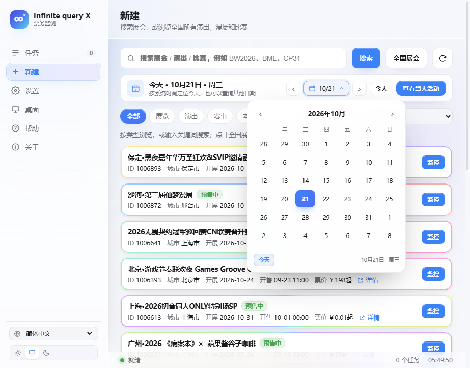 |  |

| 任务价格与购票链接 | 页码选择 |
| --- | --- |
| 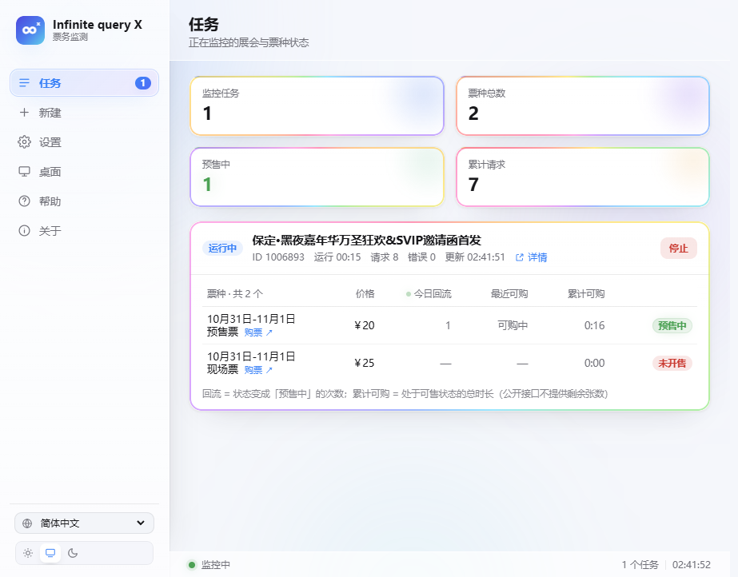 | 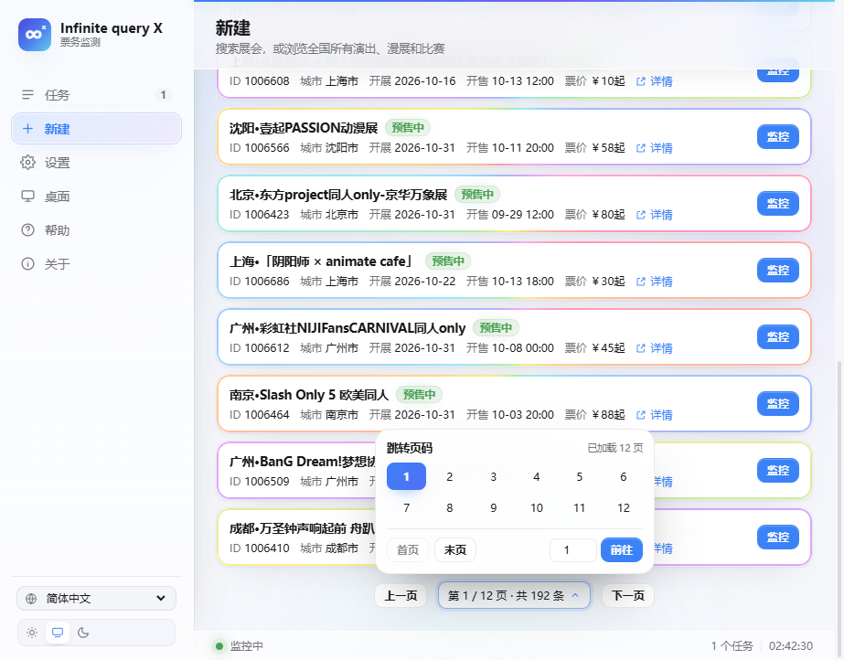 |

| 城市选择器 | 猫眼城市选择 |
| --- | --- |
| 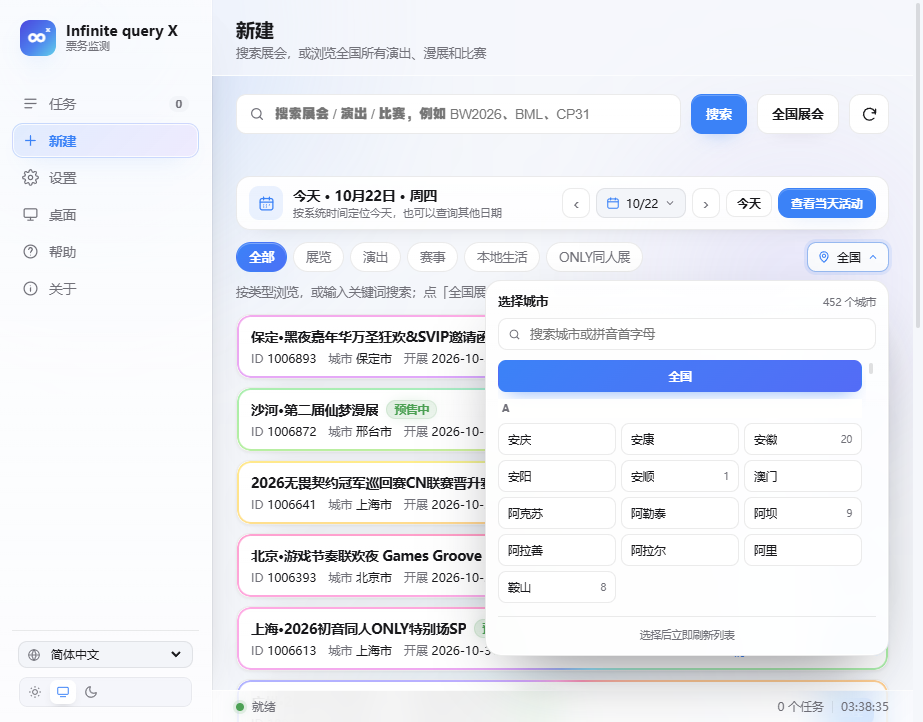 | 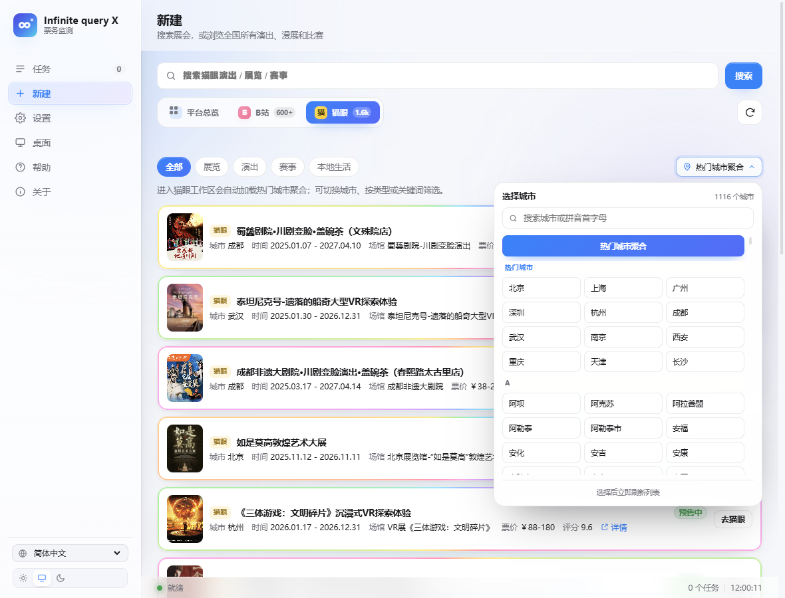 |

| 右下角提醒 | 灵动岛 |
| --- | --- |
| 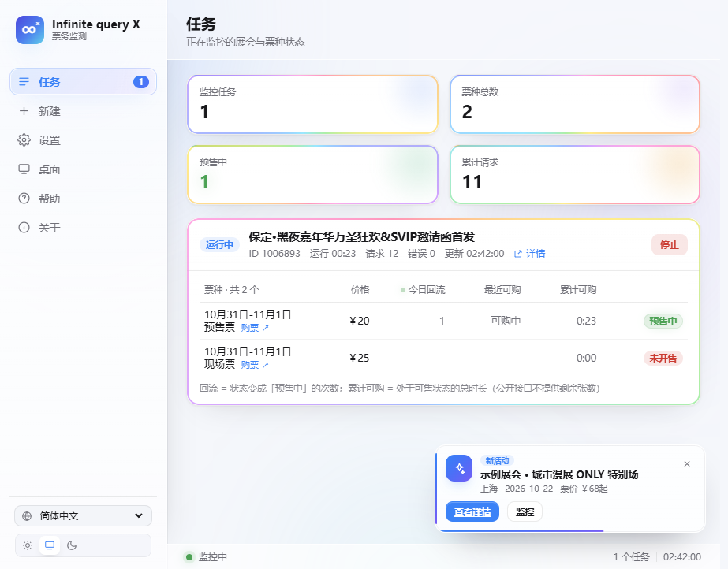 | 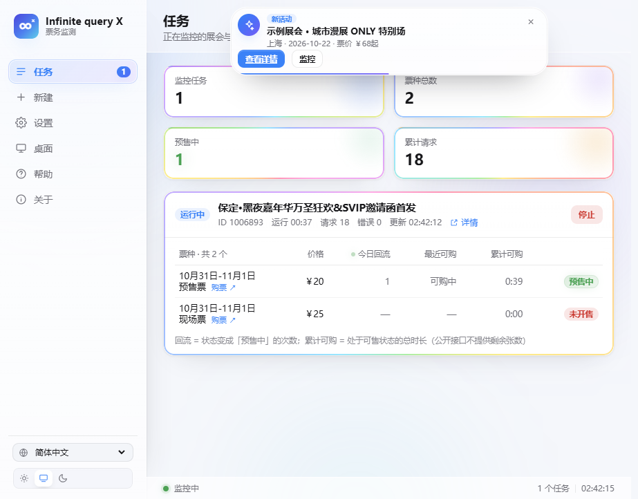 |

| 界面字体 | 卡片流光颜色 |
| --- | --- |
| 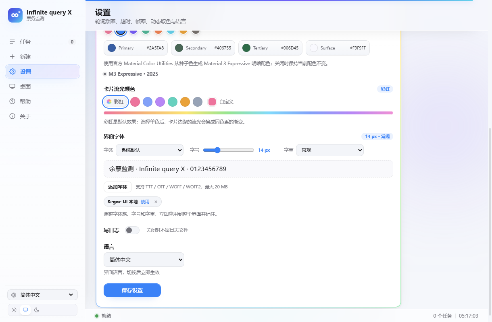 | 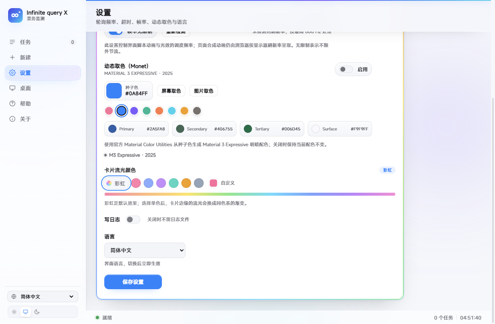 |

| Monet 动态取色 | 帮助中心 |
| --- | --- |
| 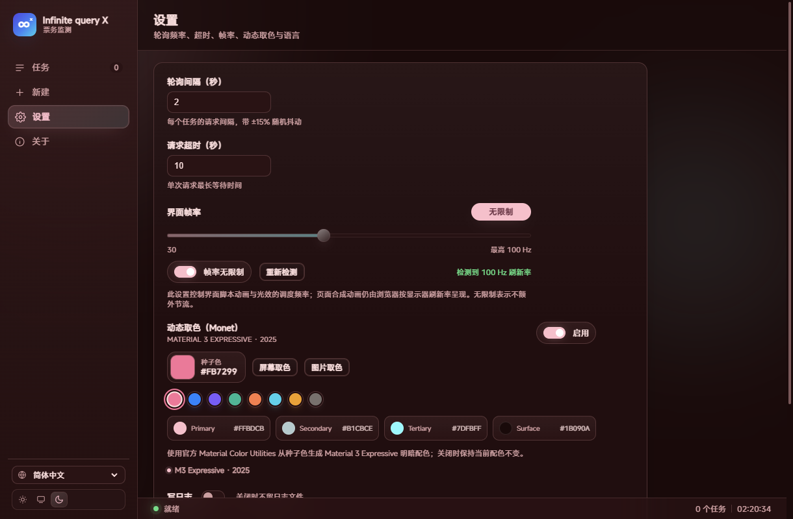 | 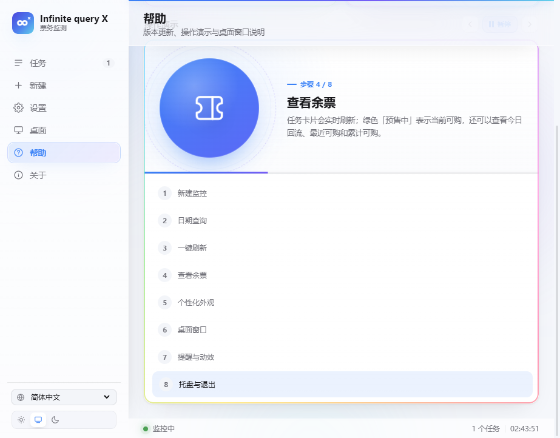 |

## 快速开始

1. 在 [Releases](https://github.com/xiaoluo68/Infinite-query-X/releases/latest) 下载 `Infinite-query-X-2.0.0.exe`（单文件，免安装）。
2. 双击运行，程序会在本机 `127.0.0.1` 起一个服务，并用系统自带 Edge 的「应用窗口」模式打开界面。
3. 关掉窗口后后台进程 60 秒内自动退出。

> 需要 Windows 10 / 11 与 Microsoft Edge。没有 Edge 时会退回默认浏览器打开。

详细说明（每个功能、设置项、动效）见 [docs/使用说明.md](docs/使用说明.md)。

## 目录结构

```
.
├─ app.py                         本地 HTTP 服务、监控线程、Edge 应用窗口、日期与字体接口
├─ bili_ticket_monitor_search.py  会员购接口、余票分类、全国活动汇总
├─ maoyan_adapter.py              猫眼网页公开数据适配、城市表与活动池
├─ notify_hub.py                  新活动 / 开票提醒的扫描、去重与队列
├─ desktop_shell.py               Windows 托盘、窗口隐藏、任务栏 / 最大化按钮
├─ static/
│  ├─ index.html                  界面结构
│  ├─ app.css                     柔光玻璃 / HyperOS 4 动效 / 日历弹层
│  ├─ app.js                      交互、动效、日期选择器、Monet、8 种语言
│  ├─ logo.svg                    图标
│  └─ vendor/                     Material Color Utilities（Apache-2.0）
├─ version_info.txt               exe 版本信息
├─ icon.ico                       应用与托盘图标
└─ docs/                          使用说明与预览图
```

## 本地运行与打包

```bat
py -m pip install pystray pillow
py app.py
```

打包单文件 exe（在仓库根目录执行）：

```bat
py -m PyInstaller --noconfirm --clean --onefile --noconsole --icon icon.ico ^
  --version-file version_info.txt --add-data "static;static" --add-data "icon.ico;." ^
  --hidden-import pystray._win32 --name "Infinite query X" app.py
```

## 说明

- 只读会员购公开接口，只做余票监测，**不提供抢票 / 下单功能**。
- 会员购公开接口不返回剩余张数，因此只能做状态级统计（有票 / 售罄 / 预售等）。
- 配置、端口、启动日志与导入的字体在 `%LOCALAPPDATA%\BW2026Monitor\`；Edge 窗口数据在同目录 `edge-profile`。
- 桌面窗口行为仅 Windows 可用；托盘不可用时程序会拒绝隐藏任务栏 / 最小化到托盘，避免窗口找不回来。

## 协议

[MIT](LICENSE) © 2026 小羅同学

界面灵感来自 Motrix 与 Xiaomi HyperOS 4；会员购接口部分基于
[TaiMiao/Bili_Ticket_Monitor](https://github.com/TaiMiao/Bili_Ticket_Monitor)。
Material Color Utilities 采用 Apache-2.0，许可证见 `static/vendor/LICENSE-material-color-utilities.txt`。

## English

**Infinite query X** is a read-only Bilibili membership-goods ticket availability monitor for Windows.
It watches exhibition / concert / event ticket status and restock history — no purchasing, no login, no automation of orders.
The UI follows a Motrix × HyperOS 4 "soft glass" design with a custom animated date picker, restock flow-edge light,
Monet (Material 3 Expressive) theming, adjustable font and frame rate, tray behaviour and 8 languages.
It also shows per-ticket prices with purchase links, new-event and on-sale notification popups (four corners or a
HyperOS-style dynamic island with adjustable duration), a page picker, and Full / Soft / Lite / Off motion levels.

Download the single-file `Infinite-query-X-1.0.0.exe` from [Releases](https://github.com/xiaoluo68/Infinite-query-X/releases/latest),
then double-click it. Full notes (Chinese) are in [docs/使用说明.md](docs/使用说明.md).
Licensed under [MIT](LICENSE).
