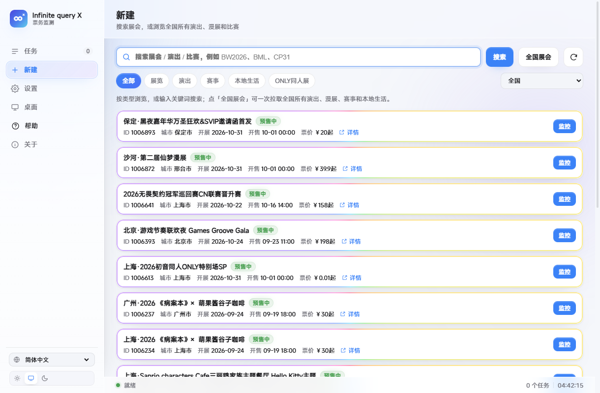
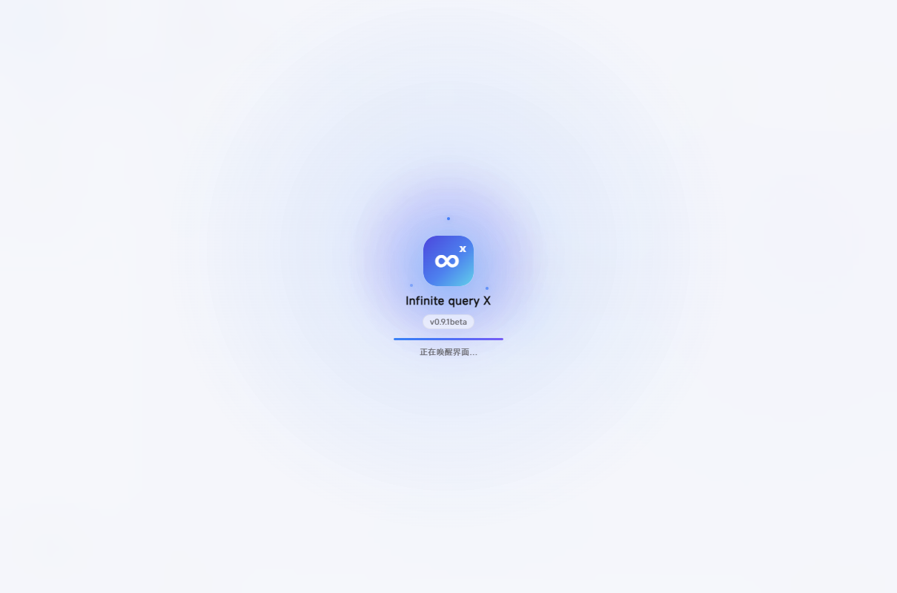
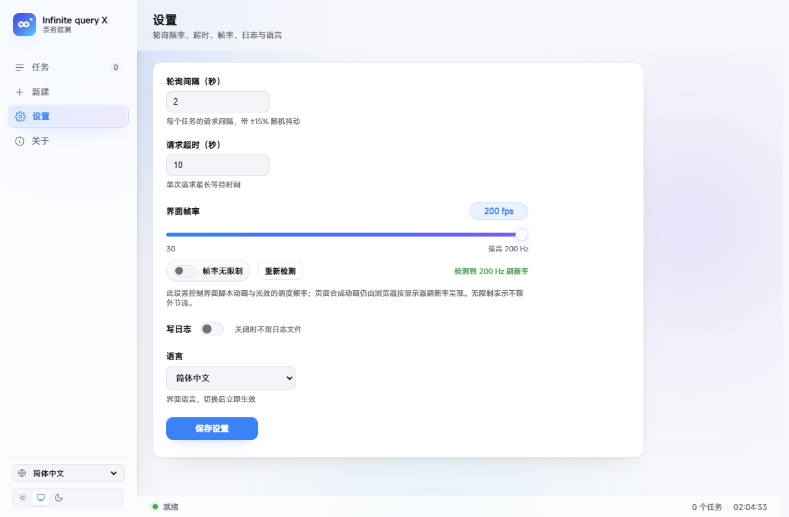
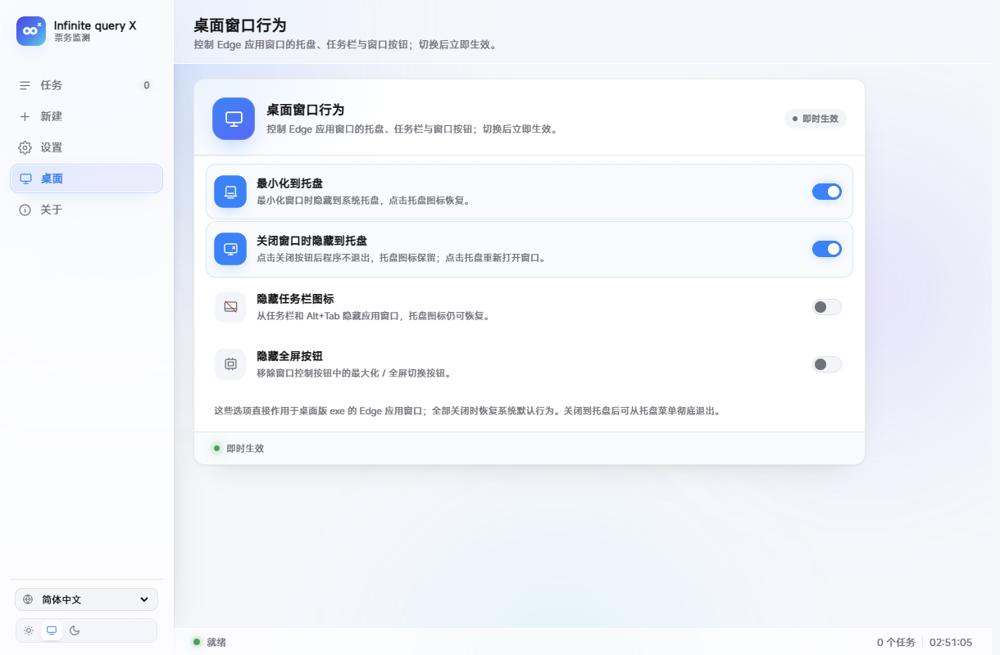
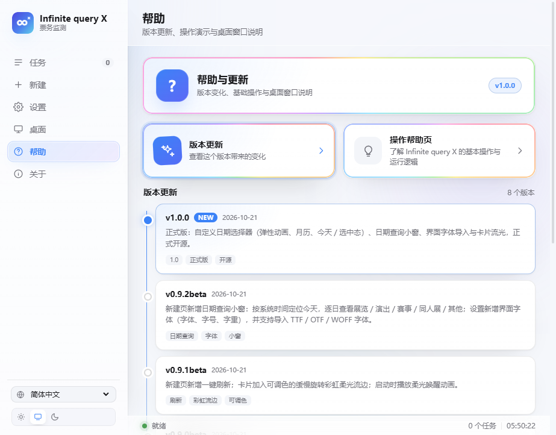
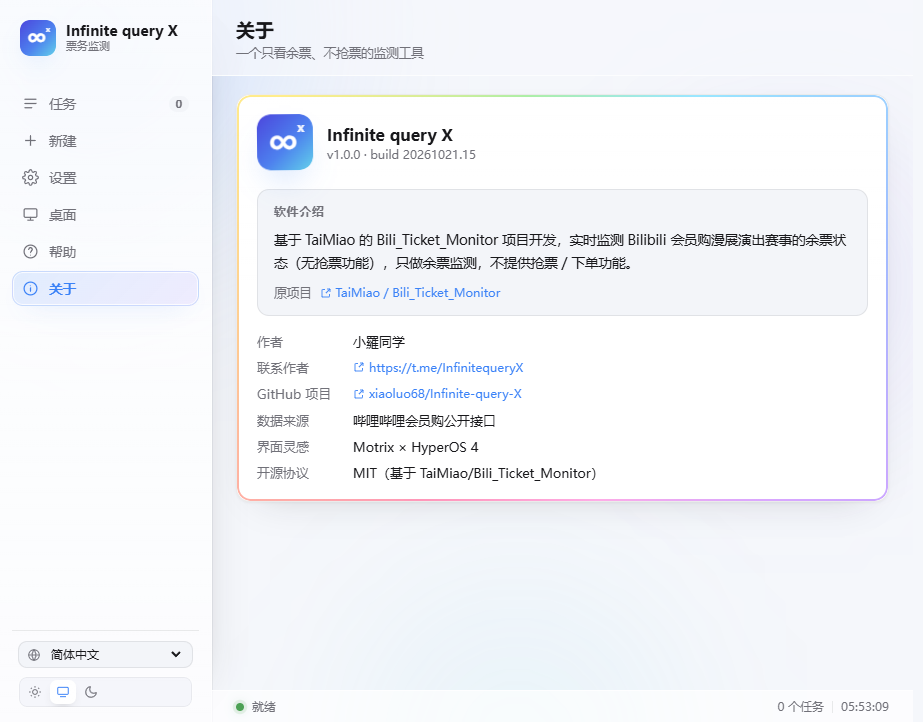

# Infinite query X

会员购余票监测工具 · 图形界面版
版本 **1.0.0** · 作者 **小羅同学** · 联系作者 **https://t.me/InfinitequeryX**
开源地址 **https://github.com/xiaoluo68/Infinite-query-X**

**软件介绍**：基于 TaiMiao 的 [Bili_Ticket_Monitor](https://github.com/TaiMiao/Bili_Ticket_Monitor) 项目开发，
实时监测 Bilibili 会员购漫展演出赛事的余票状态（无抢票功能），只做余票监测，不提供抢票 / 下单功能。

界面为 **Motrix × Xiaomi HyperOS 4** 风格：左侧栏 + 任务卡片 + 状态栏，柔光玻璃材质，
浅色 / 深色 / 跟随系统主题，单文件 exe，双击即用。


## 启动

双击 `Infinite query X.exe`。

程序会在本机 127.0.0.1 起一个服务，并用系统自带 Edge 的「应用窗口」模式打开界面
（没有地址栏和标签页，看起来就是一个独立桌面程序）。关掉窗口后后台进程 60 秒内自动退出。

## 本次新增：正式版 1.0.0

1.0.0 把日期查询做成软件自己的组件，并正式开源：

- **日期选择器**：新建页的日期栏换掉了浏览器自带的日期输入框，改为与界面同一套柔光玻璃语言的日历弹层，
  打开 / 关闭、翻月、选日都有动画，尺寸、圆角、配色和卡片流光与其它页面一致（详见下文）。
- **正式开源**：源码、使用说明和打包脚本以 MIT 协议发布在 GitHub，关于页「联系作者」下方新增了项目链接。
- **界面字体**：0.9.2 接入的字体族、12–20 px 字号、字重与本地字体导入继续保留。

0.9.1 的一键刷新、彩虹卡片流光和启动动画继续保留：

- **一键刷新**：新建页搜索或浏览后，点搜索框右侧圆形刷新按钮，保留当前关键词 / 类型 / 城市 / 页码重新拉取，
  刷新时按钮旋转、外圈亮起，完成后提示「已刷新」。
- **卡片流光**：任务卡、搜索结果、统计卡、设置卡、帮助卡、帮助演示和桌面开关行的边缘，有一圈缓慢旋转的彩虹柔光流边，
  鼠标悬停时更亮；颜色可以在「设置 → 卡片流光颜色」里换成喜欢的单色。
- **启动动画**：打开软件先播放柔光唤醒层，logo 浮现、光点环绕、进度线走满，随后 logo 飞向左侧栏，
  界面分层入场，启动过程不再是一闪而过的白屏。

参考 Xiaomi HyperOS 4「生命感美学 / 一气呵成」的设计方向，界面操作反馈整体是这样做的：

- **柔光玻璃**：侧栏、顶栏、状态栏、弹窗提示使用半透明玻璃与柔和高光，背景会随浅色 / 深色主题
  呈现蓝、紫、青三色缓慢漂移的环境光。
- **启动动画**：柔光启动层中光环扩散、光点绕 logo 旋转，logo 弹性浮现并扫过高光，名称、版本号、
  进度线依次出现；数据就绪后进度线走满，logo 飞向左侧栏品牌位，侧栏、顶栏、内容、导航分层入场。
  启动动画至少播放约 1.9 秒，数据更快也会等动画走完；超过约 4.6 秒仍未就绪会自动进入离线界面。
- **页面切换**：旧页面快速淡出，新页面带轻微位移、缩放与模糊的弹性入场；标题同步做柔光扫字，
  侧栏导航胶囊会跟手滑到新位置，不再生硬闪切。
- **按压反馈**：按钮、分类标签、导航项按下时轻微缩放并弹性回弹，不再叠加点击光晕。
- **主题切换**：点浅色 / 深色 / 跟随系统时，柔光会从按钮位置向四周扩散；主题会记住上次选择。
- **数字滚动**：监控任务、票种总数、预售中、累计请求发生变化时数字平滑滚动；任务数、票种数、预售中变化时轻微弹一下。
- **列表动效**：首次进入或新增任务时，任务卡片和票种行依次错峰浮现；停止任务时卡片淡出收起。
- **加载骨架**：搜索、切换分类、拉取全国展会、刷新结果时显示带流光扫过的骨架卡片，不再是干等的转圈。
- **提示与细节**：提示条弹性升入、带 3 秒进度线，鼠标悬停会暂停消失；开关拨动有 Q 弹形变；
  鼠标在卡片上移动时，柔光会跟随指针位置轻微流动。
- **滚动光带**：页面滚动时顶部出现一条细的蓝紫渐变阅读进度光带，顶栏在滚动后加深玻璃阴影。
- **减少动态效果**：系统开启「减少动态效果」后，动画与流光会自动降级为静态，界面仍完整可用。

> 动画以 CSS transform / opacity / filter 与轻量脚本实现，不引入第三方动画库，不改变监测逻辑，
> 也不会影响轮询、搜索、任务管理等功能。

## 新建页一键刷新

在「新建」页搜索或按类型浏览后，搜索框最右侧有一个圆形刷新按钮：

- **搜索模式**：保留关键词和当前页码，重新请求当前搜索结果。
- **分类 / 城市浏览**：保留类型、城市和页码，重新拉取当前列表。
- **全国展会**：重新读取已加载的全国列表并修正分页（不会重新扫描全国所有页面）。
- **尚未选择条件**：按当前选中的类型和城市重新加载第一页。
- **状态反馈**：刷新时按钮图标旋转、外圈亮起，结果区显示加载骨架；完成后底部弹出「已刷新」；
  失败会提示「刷新失败，稍后再试」，不会影响正在监控的任务。



## 日期查询

「新建」页搜索框下方是日期栏：左边显示「今天 · 10月21日 · 周三」和一行说明，中间是日期按钮（日历图标 + 短日期 + 箭头），
右侧是「今天」和「查看当天活动」。日期默认取系统本地时间的今天。

### 日期选择器

- **弹出位置**：点日期按钮，日历卡片贴着按钮下方弹出；如果下方空间不够，会自动翻到按钮上方，不会跑出窗口。
- **尺寸**：312 px 宽的玻璃卡片，6 行 × 7 列共 42 个日期格，上下月补位淡显，不是很窄的小浮层。
- **动画**：卡片从收起状态轻微上浮并弹性展开；42 个日期格按顺序错峰浮现；切换月份时整块日历按方向左右滑入
  （向后翻从右侧进、向前翻从左侧进）并淡入；今日有柔光描边，选中日是渐变实心并弹性放大；
  打开时按钮箭头旋转 180°，按钮出现柔光聚焦圈。
- **操作**：‹ › 翻月；点任意日期立即选中并打开当天活动小窗；底部右侧显示当前选中的日期，点「今天」回到今天；
  点卡片外面、按 Esc 或再次点日期按钮即可关闭。
- **减少动态效果**：系统开启「减少动态效果」后不再播放位移与错峰动画，只保留静态显示。

### 日期小窗

- **打开方式**：点「查看当天活动」，或在上面的日期选择器里选某一天；小窗约 913 × 722，不是很小的浮层。
- **小窗内容**：顶部显示日期与活动总数，下面按「全部 / 展览 / 演出 / 赛事 / ONLY同人展 / 其他」分类并显示数量；
  每场活动显示分类、状态、城市、开展日期区间、场馆、票价，可直接「详情」或「监控」。
- **跨天活动**：按「开始日期 ≤ 查询日 ≤ 结束日期」匹配，所以 10 月 31 日开展的跨天漫展在 11 月 1 日也能查到。
- **数据来源**：复用全国活动汇总结果，第一次打开约需 10 秒（小窗里会显示进度），之后按日期缓存，切换日期很快。
- **关闭方式**：右上角 ×、点击背景或按 Esc；打开小窗时页面背景会滚动锁定。


## 卡片流光

- 任务卡、搜索结果、统计卡、设置卡、帮助卡、帮助头图与操作演示、桌面开关行边缘，有一圈缓慢旋转的彩虹柔光流边，
  鼠标悬停时更亮；这是整个界面里唯一的常驻流光，不再有整屏扫光。
- 刷新按钮在请求中会旋转并亮起外圈光晕，完成后自动熄灭；页面切换保留柔和的淡入 / 位移，
  不再叠加横穿屏幕的光带。
- 在「设置 → 卡片流光颜色」里，默认是彩虹；也可以点 6 个快捷色圆点或使用自定义取色器，
  卡片边缘会换成同色系的渐变，选择立即生效并写入配置。
- 卡片流光由 CSS transform / opacity 合成；系统开启「减少动态效果」时自动隐藏。


## 界面字体

打开「设置 → 界面字体」：

- **字体族**：系统默认 / 微软雅黑 / Segoe UI / 宋体（衬线）/ 等宽字体，五选一。
- **添加字体**：点「添加字体」选择本地 TTF / OTF / WOFF / WOFF2（单个最大 20 MB），上传后会出现在字体下拉框和下方字体标签里；
  点「使用」立即切换，点 × 删除。字体文件保存在 `%LOCALAPPDATA%\BW2026Monitor\fonts\`，重启后仍可使用。
- **字号**：12–20 px 滑杆，默认 14 px；整个界面的文字按比例缩放，侧栏宽度会一起放大，标题不会挤成两行。
- **字重**：常规 / 中等 / 加粗三档；中等和加粗会同时加粗按钮、导航、表格等界面文字，标题和强调数字仍保持更粗的层级。
- **即时生效**：调整后立刻应用，并写入 `%LOCALAPPDATA%\BW2026Monitor\config.json`，下次打开保持。
- **预览**：设置项下方有一行字体预览，方便对比字体族和字号。


## 启动动画

启动时依次播放：柔光层亮起 → 光环扩散、三颗光点绕 logo 旋转 → logo 弹性浮现并扫过高光 →
名称、版本号、进度线出现 → 数据就绪后进度线走满、logo 飞向左侧栏 →
侧栏、顶栏、内容与导航分层入场。

启动动画至少播放约 1.9 秒，数据更快也会等动画走完；超过约 4.6 秒仍未就绪会先进入离线界面，
不会让启动层一直挡住操作。




## 界面帧率调节

打开「设置 → 界面帧率」：

- **自动检测**：启动和进入设置页时会测量显示器刷新率，滑杆范围为 **30–检测到的刷新率**，
  硬上限为 **600 Hz**。例如检测到 200 Hz，则可调 30–200；检测到 600 Hz，则可调 30–600。
- **检测失败回退**：如果浏览器因后台标签页、远程桌面等原因测不到刷新率，会回退到最高 **600 Hz**，
  仍可点「重新检测」。
- **帧率无限制**：开启后不再对脚本动画做额外节流，交给浏览器/系统按实际刷新率调度。
- **即时生效**：拖动滑杆或切换无限制后立即生效，并自动保存；下次打开继续使用上次设置。
- **适用范围**：该设置控制**脚本驱动的动画、数字滚动、指针光效、滚动光带**等更新频率。
  页面的 CSS 合成动画（如页面淡入淡出）仍由浏览器和显示器刷新率决定，网页本身无法改变显示器的物理刷新率。



## Monet 动态取色（Material 3 Expressive）

打开「设置 → 动态取色（Monet）」：

- **默认保持不变**：Monet 开关默认关闭，当前蓝色主题、背景、卡片、按钮颜色完全不动。
  关闭 Monet 时也会立即恢复当前主题的原配色。
- **官方实现**：使用官方开源库 **Material Color Utilities 0.4.0**（Apache-2.0），
  通过 `SchemeExpressive` + **2025 规范**生成 Material 3 Expressive 色板。
- **选色方式**：
  - 点击种子色色块，用颜色选择器自由选色；
  - 8 个推荐色圆点（Bilibili 粉、海蓝、紫罗兰、薄荷、日落橙、青色、琥珀、石灰）；
  - **屏幕取色**：调用浏览器 EyeDropper API，从屏幕任意位置吸取颜色；
  - **图片取色**：选择一张本地图片，用官方的 `sourceColorFromImage` 做 Monet 风格取色。
- **自动明暗**：同一颗种子色会同时生成 Light / Dark / System 三套配色，
  跟随现有「浅色 / 深色 / 跟随系统」切换。
- **M3 角色映射**：Primary、Secondary、Tertiary、Surface、Container、Outline 等角色
  映射到按钮、导航、卡片、玻璃、环境光和统计卡片；票务状态的绿 / 黄 / 红语义色保留。
- **记忆设置**：Monet 开关、种子色会写入 `%LOCALAPPDATA%\BW2026Monitor\config.json`，
  重新打开继续使用；关闭后完全回到原来的配色。


## 桌面窗口行为

侧栏「设置」下面新增了 **桌面** 页面，每个选项都是独立开关，切换后立即保存并生效，带弹性开关动画：

- **最小化到托盘**：点击最小化后，窗口真正隐藏到系统托盘；点击托盘图标恢复。
- **关闭窗口时隐藏到托盘**：点击窗口关闭按钮后程序不退出，后台和托盘图标保留。
  再次点击托盘图标会重新打开界面（Edge 新窗口通常需要几秒启动）。
- **隐藏任务栏图标**：把 Edge 应用窗口从任务栏和 Alt+Tab 中移除；
  仍可通过托盘图标恢复，避免窗口“消失”后无法找回。
- **隐藏全屏按钮**：移除窗口右上角的最大化 / 全屏切换按钮，保留最小化和关闭。

托盘菜单提供 **显示主窗口 / 隐藏到托盘 / 退出 Infinite query X**。
四项全部关闭后会恢复 Windows 默认窗口行为，托盘图标也会隐藏。
这些功能只作用于桌面版 exe 启动的 Edge 应用窗口；在普通浏览器中预览时开关仍会保存，
但窗口行为要等桌面版 exe 生效。



## 帮助中心

侧栏「关于」上方新增 **帮助** 页面，包含两个入口：

- **版本更新**：以时间线展示 1.0.0、0.9.2beta、0.9.1beta、0.9.0beta、0.8.0beta、0.7.0beta、0.6.1beta、0.6.0beta
  共 8 个版本的主要变化，当前版本会以高亮和 NEW 标记置顶。
- **操作帮助页**：用 7 个步骤演示基本操作：
  1. 新建监控；
  2. 用日期栏打开当天活动小窗；
  3. 用刷新按钮重新拉取当前结果；
  4. 查看余票和回流统计；
  5. 调整帧率、Monet、卡片流光颜色与界面字体；
  6. 设置桌面窗口行为；
  7. 从托盘恢复或退出。

操作演示会**自动轮播**，每 3.2 秒切换到下一步；右侧圆形图标会弹性切换，
外圈光环持续旋转，底部进度条同步推进，当前步骤在左侧列表中高亮。
演示还支持：

- **暂停 / 播放**；
- **上一步 / 下一步**；
- 直接点击任意步骤跳转。

系统开启「减少动态效果」时不会自动轮播，避免不必要的动画。
帮助内容会跟随简体 / 繁体切换中文，其他语言显示英文说明。




## 功能

- **任务**：每个展会一张卡片，票种状态实时刷新，可同时监控多个展会。
  卡片头部有「详情」链接，点开是会员购的对应活动页。
- **回流统计**：每个票种会记录「今日回流次数」「最近可购时间」「累计可购时长」，
  用来看哪个票种经常放票、大概多久回一次。
  （会员购公开接口不提供剩余张数，只能做状态级统计，详见下方说明）
- **新建**：按**类型**浏览（全部 / 展览 / 演出 / 赛事 / 本地生活 / ONLY同人展），
  城市可选**全国 452 个城市/地区**（含港澳台，按拼音首字母分组、带活动数量）；
  也可以关键词搜索，或点「全国展会」一次拉取全国所有类别（约 450 条，分页）；日期栏可按天查询全国活动。
  每条结果都带「详情」链接（`show.bilibili.com/platform/detail.html?id=...`）。
- **整页滚动**：鼠标滚轮可以上下滚动整个界面（侧栏和状态栏固定在两侧）。
- **记忆位置**：切换「任务 / 新建 / 设置 / 桌面 / 帮助 / 关于」时会记住各页面原来的滚动位置，返回时回到原处。
- **多语言**：简体中文、繁體中文、English、日本語、한국어、Русский、Deutsch、Français，
  左下角或「设置 → 语言」切换，立即生效并记住。
- **设置**：轮询间隔、请求超时、界面帧率（30–检测上限，最高 600，可无限制）、
  Monet 动态取色（Material 3 Expressive，可选色 / 屏幕取色 / 图片取色）、
  卡片流光颜色（彩虹或单色自定义）、界面字体（字体 / 字号 / 字重，可导入 TTF / OTF / WOFF）、写日志开关。
- **桌面**：最小化到托盘、关闭窗口时驻留托盘、隐藏任务栏图标、隐藏全屏 / 最大化按钮。
- **帮助**：版本更新时间线与带自动轮播、暂停、前后切换的操作演示。
- **关于**：版本、作者、联系作者（Telegram）、GitHub 开源项目、数据来源、协议（MIT），界面灵感标注 Motrix × HyperOS 4。



## 说明

- 只读会员购公开接口，不需要登录，只做余票监测，不提供抢票 / 下单。
- 配置、端口和启动日志在 `%LOCALAPPDATA%\BW2026Monitor\`；Edge 窗口数据在同目录 `edge-profile`。
- 找不到 Edge 时退回默认浏览器打开。
- 浅色 / 深色 / 跟随系统主题会保存在本机浏览器配置里，下次打开保持上次选择。
- 界面帧率、Monet 开关与种子色、卡片流光颜色、界面字体、桌面窗口开关都会写入
  `%LOCALAPPDATA%\BW2026Monitor\config.json`，下次打开保持上次设置。
- 动态取色使用的 Material Color Utilities 采用 Apache-2.0 协议，许可证在
  `static/vendor/LICENSE-material-color-utilities.txt`。
- 桌面窗口行为仅 Windows 可用；如果系统托盘不可用，程序会拒绝隐藏任务栏 / 最小化到托盘，
  避免窗口无法找回。

## 开源

项目以 **MIT** 协议开源，仓库地址：

**https://github.com/xiaoluo68/Infinite-query-X**

仓库内包含：

- `app.py` —— 本地 HTTP 服务、多任务监控线程、启动 Edge 窗口、日期查询与字体接口、桌面接口
- `bili_ticket_monitor_search.py` —— 会员购接口、余票分类、全国活动汇总与请求会话
- `desktop_shell.py` —— Windows 托盘、窗口隐藏、任务栏 / 最大化按钮、关闭驻留
- `static/index.html` `static/app.css` `static/app.js` —— 界面、HyperOS 4 动效、日期选择器、Monet / M3 Expressive 与 8 种语言文案
- `static/vendor/material-color-utilities.min.js` —— 官方 Material Color Utilities 本地打包（Apache-2.0）
- `static/vendor/LICENSE-material-color-utilities.txt` —— 第三方许可证
- `static/logo.svg` `icon.ico` —— 应用图标（∞ + x，icon.ico 同时用于托盘）
- `version_info.txt` —— exe 文件版本信息
- `docs/` —— 使用说明，以及本文件引用的界面预览图

仓库根目录即源码目录；本地开发时把仓库 clone 到任意位置即可。

桌面窗口功能依赖 `pystray` 与 `Pillow`：

```bat
py -m pip install pystray pillow
```

重新打包（在源码目录执行）：

```bat
cd /d "D:\哔哩哔哩会员购监测脚本\Infinite query X 源码"
py -m PyInstaller --noconfirm --clean --onefile --noconsole --icon icon.ico ^
  --version-file version_info.txt --add-data "static;static" --add-data "icon.ico;." ^
  --hidden-import pystray._win32 --name "Infinite query X" app.py
```

生成的 exe 在 `dist\Infinite query X.exe`，双击即可运行。

## 协议

MIT License，详见仓库根目录的 `LICENSE`。界面灵感来自 Motrix 与 Xiaomi HyperOS 4，
会员购接口部分基于 TaiMiao 的 [Bili_Ticket_Monitor](https://github.com/TaiMiao/Bili_Ticket_Monitor)。
